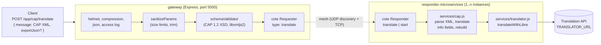

# CAP Translation Gateway

**Archived proof of concept (2024, deprecated).** A distributed mesh of Node.js microservices that takes a
[Common Alerting Protocol 1.2](https://docs.oasis-open.org/emergency/cap/v1.2/CAP-v1.2.html) alert (XML), validates it
against the OASIS schema, translates the free-text fields of its `<info>` block(s) into English through an external
translation API, and returns the alert as XML (or, optionally, as JSON). It was written to explore the idea of making
alerts readable in a common language without changing the systems that emit them (background:
[article](https://medium.com/@andrei-besleaga/innovative-usage-of-emerging-it-technologies-in-multi-hazard-early-warning-systems-7bcfe3d170b9)).
This final "exemplar pass" (October 2026) made it run, verified it, and documented what the code actually does.
It is kept as an example of an early project, not as something to deploy.

## Architecture

Two kinds of processes, discovered and connected by [cote](https://github.com/dashersw/cote) (zero-configuration
mesh: UDP broadcast discovery, TCP request/response, round-robin over the responders found).



Message flow for `POST /app/cap/translate`:

1. `gateway/middlewares/sanitize.js`: every body parameter is checked (name <= 50 chars, value <= 100 000 chars,
   JSON body <= 100 kB by Express default), strings are trimmed and control characters stripped.
2. `gateway/middlewares/schemaValidator.js`: `message` must be well-formed XML valid against `cap-gateway/cap.xsd`
   (CAP 1.2), otherwise `400`.
3. `gateway/controllers/cap.js` sends `{ type: 'translate', message, exportJson }` to the mesh and waits
   `SERVICE_TIMEOUT` ms for one responder.
4. `responder-microservices/services/cap.js` parses the XML (fast-xml-parser, values kept as strings). If the first
   `<info><language>` starts with `en` (or is absent, which CAP defines as `en-US`) the message is returned as
   received. Otherwise every string inside each `<info>` block is sent to the translation engine, except the
   enumerated/identifying fields `language, category, responseType, urgency, severity, certainty, effective, onset,
   expires, senderName, headline, web, contact` (and the `<alert>` header, which is never touched). Translated text
   replaces the original in place; a field whose translation fails keeps its original text (logged as a warning).
5. The result is rebuilt as XML (default) or returned as the parsed object when `exportJson` is `true`.

`POST /app/admin/services/pubsub` is a demo of mesh pub/sub: the responder that receives it starts a publisher that
broadcasts a random value every 30 s; every responder logs what it receives.

## Quick start

Requires Node >= 20 (verified with Node 22.22.3, npm 11.16.0; `.nvmrc` says 22) and a C++ toolchain only if no
prebuilt `libxmljs2` binary exists for your platform.

```bash
git clone https://github.com/andreibesleaga/cap-gateway && cd cap-gateway/cap-gateway
npm ci && (cd responder-microservices && npm ci) && (cd gateway && npm ci)
npm test                                   # smoke test, no network needed (see below)
```

Run it by hand (two terminals, from `cap-gateway/`):

```bash
cd responder-microservices && npm start    # as many times as you want responders
cd gateway && npm start                    # API Gateway listening at http://localhost:5000
```

Or with PM2 installed globally (`npm i -g pm2`): `npm start` runs `pm2 start all.json` (one gateway, two responders,
logs in `cap-gateway/LOGS/`); `pm2 kill` stops everything. `npm run monitor` opens the cote mesh monitor
(`monitor.js`, web UI on port 5555).

Send a sample alert:

```bash
curl -s -X POST http://localhost:5000/app/cap/translate -H 'content-type: application/json' \
  --data-binary "$(node -e "console.log(JSON.stringify({message: require('fs').readFileSync('samples/alert-ro.xml','utf-8')}))")"
```

Without a reachable translation engine the Romanian sample comes back unchanged (per-field fallback) with status
`200`. The public `https://libretranslate.com` instance needs an API key (`TRANSLATOR_KEY`); a self-hosted
[LibreTranslate](https://github.com/LibreTranslate/LibreTranslate) works without one
(`TRANSLATOR_URL=http://localhost:5050/translate`, for example).

## Configuration

All settings are environment variables read in `gateway/constants.js` and `responder-microservices/constants.js`;
the defaults are the values the project always used.

| Variable | Process | Default | Meaning |
| --- | --- | --- | --- |
| `APP_PORT` | gateway | `5000` | HTTP(S) listen port |
| `APP_URL` | gateway | `http://localhost` | Only used in the start-up log line |
| `NODE_ENV` | gateway | `development` | `production` serves HTTPS with `cap-gateway/key.pem` and `cap-gateway/cert.pem` |
| `ACCESS_LOGS_DIR` | gateway | `./LOGS` | Directory (relative to the working directory) for the rotating Apache-style `access.log`; empty disables it |
| `SERVICE_TIMEOUT` | gateway | `3000` | Milliseconds to wait for a responder before answering `500` |
| `TRANSLATOR_URL` | responder | `https://libretranslate.com/translate` | LibreTranslate-compatible `POST /translate` endpoint |
| `TRANSLATOR_KEY` | responder | empty | API key sent as `api_key` (LibreTranslate) or used by the alternative engines |

Only `translateWithLibre` is wired in. `services/translator.js` also contains Yandex, DeepL, Microsoft and MyMemory
clients with the same `(text, source, target)` signature; switching means passing one of them as the third argument
of `CapService.translate` (there is no runtime switch).

## Message formats

Request (JSON): `{ "message": "<CAP 1.2 XML as a string>", "exportJson": false }`.

Responses:

| Case | Status | Body |
| --- | --- | --- |
| English alert (or no `<language>`) | 200 | the XML exactly as received (trimmed), or the parsed object if `exportJson` |
| Non-English alert | 200 | the same XML with the translated `<info>` text fields replaced in place; `<language>` is left as in the input |
| `exportJson: true` | 200 | JSON object: `{ "?xml": {...}, "alert": { "identifier": ..., "info": {...}, "@_xmlns": "urn:oasis:names:tc:emergency:cap:1.2" } }` (attributes are prefixed `@_`; several `<info>` become an array) |
| `message` not well-formed XML | 400 | `{ "error": "message is not well-formed XML" }` |
| Well-formed but not CAP 1.2 | 400 | `{ "error": "XML does not conform to the Common Alert Protocol 1.2 XSD Schema" }` |
| Body parameter too large / malformed | 400 | `{ "error": "Malformed Request" }` |
| No responder within `SERVICE_TIMEOUT` | 500 | `{ "error": "Request timed out." }` |
| Unknown route | 404 | `{ "error": "Not found" }` |

Samples: `cap-gateway/samples/alert-en.xml`, `cap-gateway/samples/alert-ro.xml`. Encoding is UTF-8 throughout; the
XML declaration and the CAP namespace are preserved on output.

## Tests and checks

From `cap-gateway/`:

- `npm test` runs `scripts/smoke.mjs`: part A calls the translation service in-process with a stub engine
  (English passthrough, in-place translation, skipped fields, lossless declaration/namespace, JSON export, missing
  language); part B starts a stub translation HTTP server plus one responder and the gateway as child processes and
  checks the real HTTP path (404, 400 malformed, 400 non-CAP, 200 English, 200 translated, JSON export). 16 checks,
  deterministic, no external network.
- `npm run lint` (ESLint 10, `eslint.config.js`) and `npm run format:check` / `npm run format` (Prettier 3).

## Project layout

```
cap-gateway/                      project root (PM2 file, mesh monitor, toolchain, smoke test)
  all.json                        PM2 process file: gateway + two responders
  cap.xsd                         OASIS CAP 1.2 schema (copyright OASIS Open 2010)
  monitor.js                      cote MonitoringTool (mesh dashboard)
  eslint.config.js, .prettierrc   shared lint/format configuration
  samples/                        valid CAP 1.2 alerts (en, ro)
  scripts/smoke.mjs               smoke test (npm test)
  gateway/                        Express API gateway
    index.js                      server, middleware, routes, HTTP/HTTPS
    constants.js                  configuration (env) and endpoint paths
    errors.js                     error/reply helpers
    controllers/{cap,admin}.js    routes -> cote requesters
    middlewares/{sanitize,schemaValidator}.js
    logger.js                     winston console logger
  responder-microservices/        cote responder (run 1..n instances)
    index.js                      responder + demo subscriber
    constants.js                  translation engine settings (env)
    controllers/{cap,admin}.js
    services/cap.js               parse -> translate <info> -> rebuild
    services/translator.js        translation engine clients
    logger.js
```

Each of the three directories has its own `package.json` and lockfile; the gateway and the responders share no code.

## Status and limitations

- Deprecated and archived; no further development. Kept runnable and documented as an early-project exemplar.
- No authentication, no rate limiting, no TLS on the mesh; cote discovery is open UDP broadcast on the local network.
- Translation replaces the original `<info>` text; the original language is not kept alongside and `<language>`
  still carries the source code. Every string in `<info>` not in the skip list is sent to the engine, including
  `<polygon>`/`<circle>`/`<geocode>` values and `<parameter>` names.
- One translation request per field, sequential; a slow engine can exceed `SERVICE_TIMEOUT` (3 s default).
- Only the first `<info>` decides the language; the others are translated with that same source language.
- Transitive `uuid@3.4.0` (through `cote`) has an unpatchable moderate advisory; see `SECURITY.md`.

## Licence

MIT, Copyright (c) 2024-2026 Andrei N. Besleaga. `cap-gateway/cap.xsd` is the OASIS CAP 1.2 schema
(Copyright OASIS Open 2010, all rights reserved, redistributed unchanged).
