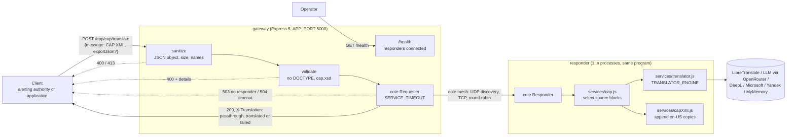
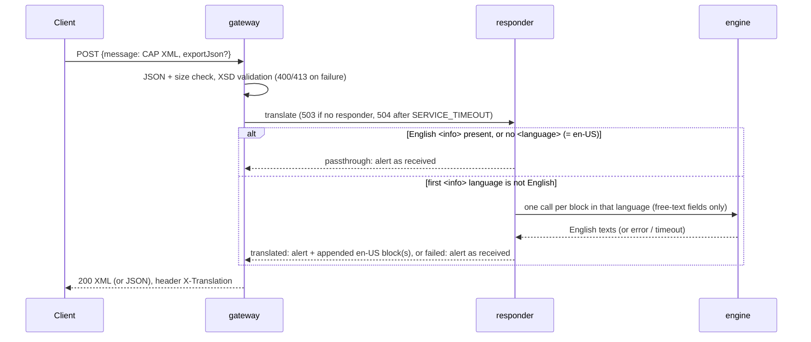

# CAP Translation Gateway

**Archived proof of concept (2024, deprecated).** A small mesh of Node.js services that receives a
[Common Alerting Protocol 1.2](https://docs.oasis-open.org/emergency/cap/v1.2/CAP-v1.2.html) alert (XML), checks it
against the OASIS schema and, when the alert has no English `<info>` block, **appends one**: a copy of the original
block with `<language>en-US</language>` and its free-text fields translated. The original alert is never changed
(background: [article](https://medium.com/@andrei-besleaga/innovative-usage-of-emerging-it-technologies-in-multi-hazard-early-warning-systems-7bcfe3d170b9)).
The October 2026 exemplar pass made it run, tested it at four levels and documented what the code does. It is kept
as an example of an early project, not as something to deploy.

## Architecture

### System



### One request



Details: [docs/ARCHITECTURE.md](docs/ARCHITECTURE.md). Decisions: [docs/adr/](docs/adr/).

## Quick start

Node 22 (`.nvmrc`; tested with 22.22.3 and npm 10.9.8). From `cap-gateway/`:

```bash
npm ci && (cd gateway && npm ci) && (cd responder-microservices && npm ci)
npm test                       # unit + BDD with the stub engine, no network, about 15 s
```

Run the services (two terminals, or `npm start` with a global [PM2](https://pm2.keymetrics.io/) for one gateway and
two responders):

```bash
# LibreTranslate (default engine), self-hosted:
docker run -d --rm --name libre -p 127.0.0.1:5055:5000 libretranslate/libretranslate:v1.9.6 \
  --load-only en,ro,fr,es,de,fi --update-models   # first start downloads the models
cd responder-microservices && TRANSLATOR_URL=http://127.0.0.1:5055/translate npm start
# or an LLM through OpenRouter:
cd responder-microservices && TRANSLATOR_ENGINE=llm OPENROUTER_API_KEY=... npm start
# or a test run without any engine:
cd responder-microservices && TRANSLATOR_ENGINE=stub npm start

cd gateway && npm start        # http://localhost:5000
curl -s -X POST http://localhost:5000/app/cap/translate -H 'content-type: application/json' \
  --data-binary "$(node -e "console.log(JSON.stringify({message: require('fs').readFileSync('samples/alert-ro.xml','utf-8')}))")"
```

## Configuration

Environment variables, read once at start-up; an invalid value stops the process with a clear message.

| Variable | Process | Default | Meaning |
| --- | --- | --- | --- |
| `TRANSLATOR_ENGINE` | responder | `libretranslate` | `libretranslate`, `llm`, `deepl`, `microsoft`, `yandex`, `mymemory`, `stub` |
| `TRANSLATOR_URL` | responder | engine's public endpoint | Overrides the endpoint (not used by `llm`) |
| `TRANSLATOR_KEY` | responder | empty | API key; required for `deepl`, `microsoft`, `yandex`; optional for LibreTranslate and MyMemory |
| `TRANSLATOR_REGION` | responder | empty | Azure region header for `microsoft` |
| `TRANSLATOR_TIMEOUT` | responder | `8000` | Milliseconds per engine request |
| `OPENROUTER_API_KEY` | responder | none | Required for `llm` |
| `LLM_BASE_URL` | responder | `https://openrouter.ai/api/v1` | Any OpenAI-compatible Chat Completions API |
| `LLM_MODEL` | responder | `google/gemini-3.5-flash-lite` | Model id |
| `APP_PORT` | gateway | `5000` | Listen port |
| `NODE_ENV` | gateway | `development` | `production` serves HTTPS with `cap-gateway/key.pem` and `cert.pem` |
| `SERVICE_TIMEOUT` | gateway | `20000` | Milliseconds to wait for a responder |
| `BODY_LIMIT` | gateway | `100kb` | Largest JSON body |
| `ACCESS_LOGS_DIR` | gateway | `./LOGS` | Rotating access log directory; empty disables it |
| `APP_URL` | gateway | `http://localhost` | Only used in the start-up log line |
| `LOG_LEVEL` | both | `info` | `error`, `warn`, `info`, `debug` |

## What comes back

Request: `{ "message": "<CAP 1.2 XML>", "exportJson": false }`. Before (`samples/alert-ro.xml`, shortened) and after,
as returned with the default engine (LibreTranslate 1.9.6, recorded 2026-10-21):

```xml
<info>
  <language>ro-RO</language>
  <category>Met</category>
  <event>Furtună puternică</event>
  <urgency>Expected</urgency> ...
  <headline>Avertizare de furtună puternică</headline>
  <description>Sunt așteptate furtuni cu grindină și vânt puternic în această după-amiază.</description>
  <instruction>Rămâneți în interior, departe de ferestre.</instruction>
  <area><areaDesc>Județul Exemplu</areaDesc></area>
</info>
<!-- appended by the gateway; the block above is returned byte for byte -->
<info>
  <language>en-US</language>
  <category>Met</category>
  <event>Strong storm</event>
  <urgency>Expected</urgency> ...
  <headline>Strong storm warning</headline>
  <description>Storms with hail and strong wind are expected this afternoon.</description>
  <instruction>Stay inside, away from the windows.</instruction>
  <area><areaDesc>Example County</areaDesc></area>
</info>
```

Translated fields: `event, audience, senderName, headline, description, instruction, contact, resourceDesc,
areaDesc`. Everything else in the block (categories, response types, urgency, severity, certainty, event codes,
dates, web, parameters, resource MIME type and URI, polygons, circles, geocodes, altitude, ceiling) is copied
verbatim. The `<alert>` header is never touched. The output validates against `cap.xsd`.

| Case | Status | `X-Translation` | Body |
| --- | --- | --- | --- |
| English `<info>` present, or no `<language>` | 200 | `passthrough` | the alert as received (trimmed) |
| Non-English alert, engine succeeded | 200 | `translated` | the alert plus one en-US block per block in the first `<info>`'s language |
| Engine failed (network, timeout, HTTP error, invalid answer) | 200 | `failed` | the alert as received, nothing appended |
| `exportJson: true` (boolean only) | 200 | as above | the same alert parsed to JSON (`@_` attributes, several `<info>` as an array) |
| Not a string / DOCTYPE / not well-formed / not CAP 1.2 | 400 | none | `{ "error": ..., "details"?: [...] }` |
| Body not JSON | 400 | none | `{ "error": "Malformed Request" }` |
| Body over `BODY_LIMIT` | 413 | none | `{ "error": "Request body larger than 100kb" }` |
| No responder connected | 503 | none | `{ "error": "No translation responder available" }` (immediately) |
| No responder reply in `SERVICE_TIMEOUT` | 504 | none | `{ "error": "No responder replied within ... ms" }` |
| Unexpected responder or mesh error | 500 | none | `{ "error": ... }` |
| `GET /health` | 200 / 503 | none | `{ "status": "ok" \| "unavailable", "responders": n }` |
| Unknown route | 404 | none | `{ "error": "Not found" }` |

Why an engine failure is still a `200`: [docs/adr/0003-failure-behaviour.md](docs/adr/0003-failure-behaviour.md).

## Tests

From `cap-gateway/`, details in [docs/TESTING.md](docs/TESTING.md). Results recorded on 2026-10-21 (Node 22.22.3,
npm 10.9.8, WSL2 Linux, Docker 29.8.1) after a fresh `npm ci` in all three packages:

| Tier | Command | Result |
| --- | --- | --- |
| Lint / format | `npm run lint`, `npm run format:check` | 0 problems / all files formatted |
| Unit (node:test) | `npm run test:unit` | 72 tests, 72 passed (same on 3 repeated runs) |
| Coverage | `npm run test:coverage` (gate: 90 % lines) | services and middlewares 100 % lines, 98.95 % branches; all source 99.70 % lines |
| BDD + e2e, stub engine (CI) | `npm run test:bdd` | 29 scenarios, 205 steps passed, about 14 s (same on 2 repeated runs) |
| e2e, LibreTranslate in Docker | `npm run test:e2e:libre` | 18 scenarios, 142 steps passed (en, ro, fr, es, de, fi); container ready in 193 s (Finnish models downloaded), scenarios 35 s |
| e2e, LLM (opt-in, not in CI) | `OPENROUTER_API_KEY=... npm run test:e2e:llm` | 9 scenarios, 69 steps passed; `google/gemini-3.5-flash-lite`, 7 requests, 0 retries, reported cost USD 0.001545 |

The DeepL, Microsoft, Yandex and MyMemory clients are **contract-tested with a mocked `fetch`, not live-verified**.

## Project layout

```
cap-gateway/                 PM2 file (all.json), mesh monitor (monitor.js), cap.xsd, toolchain, tests
  gateway/                   Express gateway: app.js (routes), mesh.js, middlewares/, controllers/
  responder-microservices/   cote responder: config.js, services/{cap,capXml,translator}.js
  samples/                   valid CAP 1.2 alerts: en, ro, fr, es, de, fi
  test/                      unit tests, fixtures, test helpers (fake fetch, fake engines, mesh launcher)
  features/                  BDD scenarios by persona, step definitions
  scripts/                   e2e-libre.mjs (Docker), e2e-llm.mjs (opt-in)
docs/                        ARCHITECTURE, TESTING, OPERATIONS, adr/
```

## Limitations

- Deprecated and archived; no further development.
- No authentication, no rate limiting, no TLS on the mesh; cote finds peers by open UDP broadcast on the local network.
  Do not expose it to untrusted networks ([SECURITY.md](SECURITY.md)).
- Machine translation of public-safety text can be wrong; the original block stays authoritative.
- Only the language of the first `<info>` is translated (see [ADR 0001](docs/adr/0001-append-english-info-block.md)).
- Alert text is sent to the configured engine; with a hosted engine or the LLM it leaves your network.
- Transitive `uuid@3.4.0` (through `cote`) carries one moderate advisory with no fix in `cote`; see [SECURITY.md](SECURITY.md).

## Licence

MIT, Copyright (c) 2024-2026 Andrei N. Besleaga. `cap-gateway/cap.xsd` is the OASIS CAP 1.2 schema (Copyright OASIS
Open 2010), redistributed unchanged.
