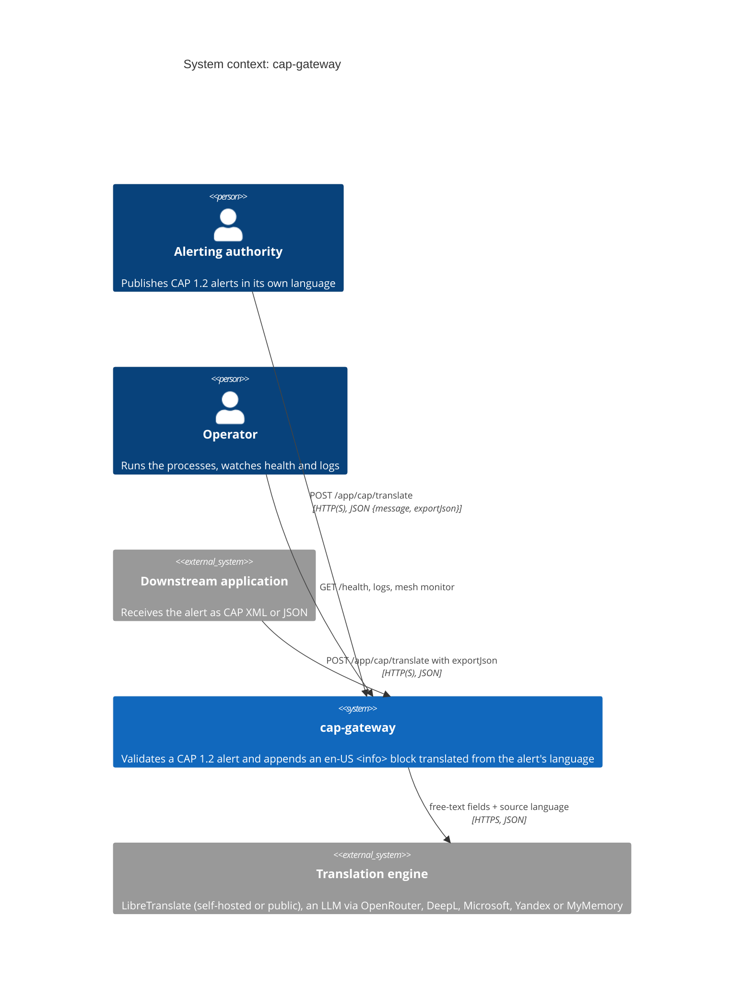
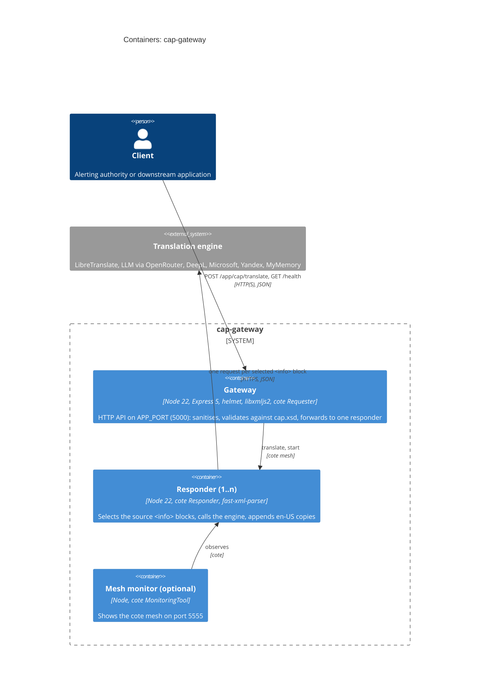
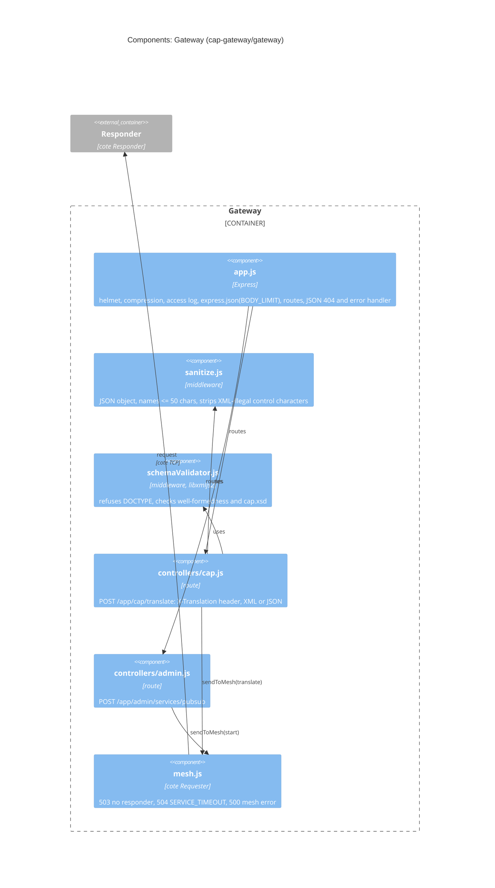
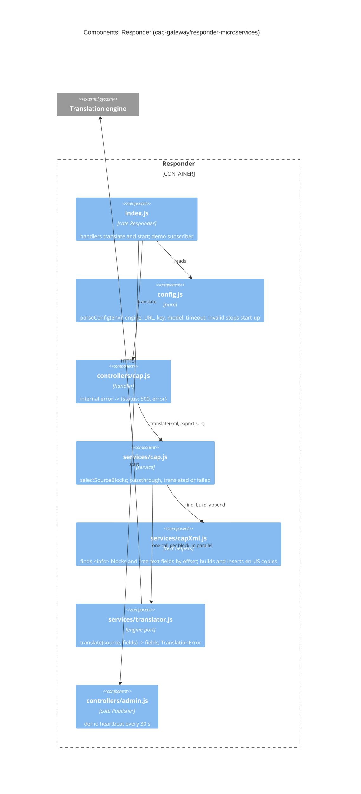
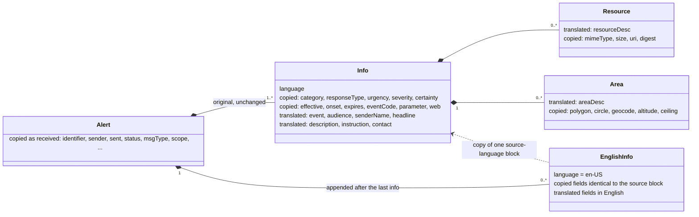
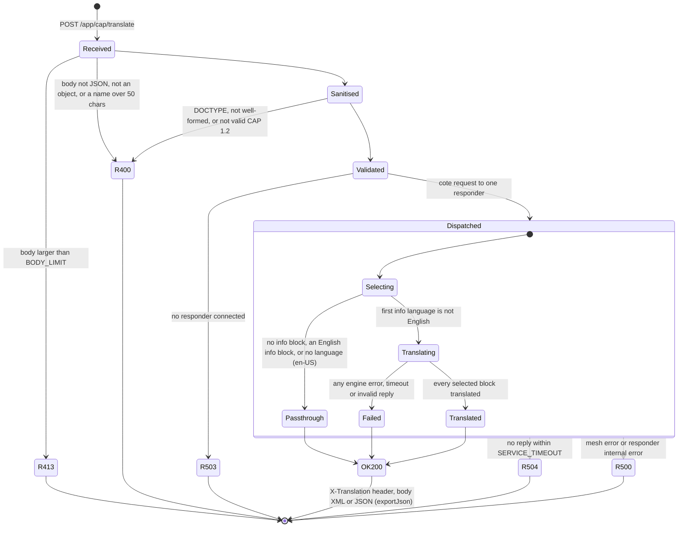
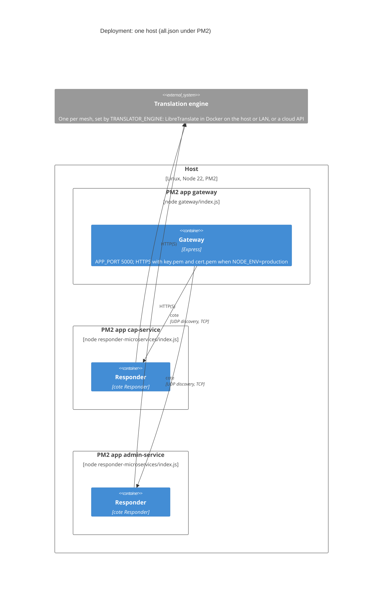

# Architecture

The structure follows [arc42](https://arc42.org/overview) (sections 1–12); the diagrams follow the
[C4 model](https://c4model.com/) (context, containers, components, deployment). Every diagram is Mermaid (checked
with mermaid-cli 11.4.2). The code is the reference: each element names the file that implements it.

## 1. Introduction and goals

cap-gateway receives Common Alerting Protocol (CAP 1.2) alerts in any language and returns them with an English
version appended, so English-speaking responders and systems can act on them. The original alert is never changed.

| Quality goal | What it means here | Where it is checked |
| --- | --- | --- |
| Integrity of the alert | the original bytes are returned unchanged; English is an added `<info>` block | BDD `01`, unit `capXml.test.js` |
| Never block an alert | an engine failure returns the original alert with `200` and `X-Translation: failed` | BDD `03`, ADR 0003 |
| Safe input | only valid CAP 1.2 XML is accepted; no DOCTYPE, size limit | BDD `04`, `schemaValidator.js` |
| Replaceable engine | one engine interface; the engine is chosen by configuration | unit `translator.test.js`, ADR 0002 |

## 2. Constraints

- CAP 1.2 (OASIS), validated against the official `cap.xsd`.
- Node.js 22 (`.nvmrc`); three npm packages (root tooling, `gateway/`, `responder-microservices/`).
- cote 1.2.0 (final release) for the service mesh: UDP broadcast discovery, so all processes share one network.
- Archived proof of concept: no authentication, no rate limiting (see `SECURITY.md`).

## 3. Context and scope

Only the free-text fields of a non-English alert leave the system, and only towards the configured engine
(`SECURITY.md`, "Data sent to third parties").

## 4. Solution strategy

| Decision | Why | Record |
| --- | --- | --- |
| Append an `en-US` `<info>` block, never replace text | CAP 1.2 carries several languages as several `<info>` blocks; the authority's wording stays authoritative | [ADR 0001](adr/0001-append-english-info-block.md) |
| Work on the original text by offsets, never re-serialise | declaration, namespaces, comments, CDATA and entities survive byte for byte | §6.1 |
| One engine interface, chosen at start-up | engines differ in cost, privacy and quality; tests use a stub | [ADR 0002](adr/0002-translation-engines-and-llm-contract.md) |
| Fail to the original alert | a translation is an aid; an alert must never be lost or delayed by it | [ADR 0003](adr/0003-failure-behaviour.md) |
| Stateless processes on a cote mesh | add responders to scale; no database, no queue | §5, §7 |

## 5. Building block view

### 5.1 Containers

The gateway reaches the responders over the cote mesh: UDP broadcast discovery, then TCP, round-robin over the
connected responders. The gateway and the responders share no code. Every responder runs the same program
(`responder-microservices/index.js`); `all.json` starts two of them. Each responder also holds the demo pub/sub
pair: `POST /app/admin/services/pubsub` starts one publisher that broadcasts `randomUpdate` every 30 s to the
subscribers of all responders.

#### Gateway components

#### Responder components

### 5.2 Gateway components (`cap-gateway/gateway/`)

| File | Role |
| --- | --- |
| `index.js` | Creates one cote `Requester` per route, the rotating access log, and listens (HTTPS when `NODE_ENV=production`) |
| `app.js` | Express app without network side effects (tested in-process): helmet, compression, access log, `express.json` with `BODY_LIMIT`, `GET /health`, routes, JSON 404 and error handler |
| `middlewares/sanitize.js` | Body must be a JSON object with parameter names of at most 50 characters; strings are trimmed and stripped of XML-illegal control characters |
| `middlewares/schemaValidator.js` | `message` must be a string, contain no DOCTYPE (refused before parsing, so no entity expansion or external entities), be well-formed and valid against `cap.xsd` (libxmljs2, schema parsed once) |
| `mesh.js` | `sendToMesh`: 503 at once when no responder is connected, 504 when none replies within `SERVICE_TIMEOUT`, 500 for other mesh errors |
| `controllers/cap.js` | `POST /app/cap/translate`: forwards `{ type: 'translate', message, exportJson }`, sets `X-Translation`, answers XML or JSON |
| `controllers/admin.js` | `POST /app/admin/services/pubsub`: starts the demo pub/sub heartbeat on one responder |
| `constants.js` | Environment configuration, endpoints, status codes |

### 5.3 Responder components (`cap-gateway/responder-microservices/`)

| File | Role |
| --- | --- |
| `index.js` | Reads the configuration, builds the engine and the service, registers the `translate` and `start` handlers, and the demo subscriber |
| `config.js` | `parseConfig(env)`: pure, frozen result; unknown engine, missing key or bad timeout stops the process at start-up. `describeConfig` logs engine, endpoint origin, model and timeout, never a key |
| `services/capXml.js` | Text-level CAP helpers: finds `<info>` blocks and their free-text fields by offset (comments, CDATA and PIs masked so they cannot fake markup; namespace prefixes supported), builds the English copy, inserts it after the last `<info>` with the same indentation and line ends |
| `services/cap.js` | `selectSourceBlocks` and `translate`: passthrough, translated or failed (see below); `exportJson` parses the result with fast-xml-parser (values kept as strings) |
| `services/translator.js` | One interface for every engine: `translate(sourceLanguage, fields) -> fields`; errors are a `TranslationError` with a reason (`timeout`, `network`, `http <status>`, `invalid-response`) |
| `controllers/cap.js` | Mesh handler; an unexpected exception becomes `{ status: 500, error }`, details only in the log |
| `controllers/admin.js` | Demo publisher: one per responder, started once, broadcasts a random value every 30 s |

## 6. Runtime view

### 6.1 Translation flow

1. `findInfoBlocks` locates every `<info>`; a block without `<language>` is `en-US` (CAP 1.2 default).
2. `selectSourceBlocks`: no `<info>` or any English block (`en`, `en-*`) means **passthrough**. Otherwise the source
   language is the first block's, and every block in that language (case-insensitive) is selected.
3. For each selected block with free text, one engine call with all its fields (`event`, `audience`, `senderName`,
   `headline`, `description`, `instruction`, `contact`, `resourceDesc`, `areaDesc`; a field that repeats gets keys
   `areaDesc.1`, `areaDesc.2`, ...). Calls for different blocks run in parallel.
4. Any failure fails the whole alert: **failed**, alert returned as received, nothing partial appended.
5. Otherwise each copy is the original block's exact text with `<language>` set to `en-US` and each field's content
   replaced by the escaped translation; the copies are inserted after the last original `<info>`: **translated**.

The original bytes are never re-serialised, so declaration, namespace, comments, CDATA and entities stay as sent.
Only the gateway's XSD check guarantees the input is CAP 1.2; the responder relies on it.

#### What is translated, what is copied

### 6.2 States of one request

`OK200` carries `X-Translation: passthrough | translated | failed`. In `passthrough` and `failed` the body is the
alert exactly as received; in `translated` it is the alert with the en-US copies appended.

## 7. Deployment view

The two PM2 names (`cap-service`, `admin-service`) run the same responder program with the same environment, so both
use the same engine and either answers either request.
More responders on other hosts of the same broadcast domain join the mesh by themselves; separate meshes on one
network need distinct `COTE_ENV` values. Runbook: [OPERATIONS.md](OPERATIONS.md).

## 8. Cross-cutting concepts

- **Configuration:** environment variables only, read once at start-up; an invalid value stops the process
  (`gateway/constants.js`, `responder-microservices/config.js`).
- **Errors:** every error body is JSON `{error, details?}`; engine failures are not errors for the client (§6.2).
- **Logging:** winston on both sides; one line per alert in the responder (`translate: passthrough|translated|failed`);
  rotating Apache-style access log in the gateway; keys are never logged.
- **Security:** DOCTYPE refused before parsing, XSD validation, body limit, helmet headers, escaped output
  (`SECURITY.md`).

### 8.1 Translation engines

| Engine | Request | Status |
| --- | --- | --- |
| `libretranslate` (default) | `POST /translate` with `q` as an array, `source` primary subtag, `target: en`, optional `api_key` | live-verified against `libretranslate/libretranslate:v1.9.6` |
| `llm` | OpenAI-compatible `POST /chat/completions`, `temperature: 0`, `response_format: json_object`, strict JSON contract, one retry except for 4xx other than 429 | live-verified through OpenRouter with `google/gemini-3.5-flash-lite` |
| `deepl` | `POST /v2/translate`, `DeepL-Auth-Key` header, `EN-US` target, `api-free` host for `:fx` keys | contract-tested, not live-verified |
| `microsoft` | Translator v3 `?api-version=3.0&from=..&to=en`, `[{Text}]` body, subscription key and optional region headers | contract-tested, not live-verified |
| `yandex` | Cloud Translate v2, `Api-Key` header, `texts` array | contract-tested, not live-verified |
| `mymemory` | one `GET /get?q=..&langpair=xx\|en` per text; an error inside a 200 response is a failure | contract-tested, not live-verified |
| `stub` | no network; returns `[en] <text>` | tests only |

The LLM contract is in [adr/0002-translation-engines-and-llm-contract.md](adr/0002-translation-engines-and-llm-contract.md).

## 9. Architecture decisions

[ADR 0001](adr/0001-append-english-info-block.md) append an English block ·
[ADR 0002](adr/0002-translation-engines-and-llm-contract.md) engines and the LLM contract ·
[ADR 0003](adr/0003-failure-behaviour.md) failure behaviour.

## 10. Quality requirements

The quality scenarios are the BDD features, one per persona (`cap-gateway/features/`, see
[TESTING.md](TESTING.md)): `01` alerting authority, `02` downstream JSON consumer, `03` operator, `04` security
reviewer.

## 11. Risks and technical debt

| Risk | Effect | Mitigation today |
| --- | --- | --- |
| No authentication, no rate limiting | anyone who reaches the port can use the engine budget | do not expose it; put it behind an authenticating proxy |
| cote discovery has no key | any process on the network can join as a responder | isolated network; distinct `COTE_ENV` |
| cote 1.2.0 is the final release | residual `uuid` advisory; `/health` reads a private socket list | documented in `SECURITY.md`; replacing cote is the fix |
| Engines other than LibreTranslate and the LLM are contract-tested only | an API change is noticed only in use | the `failed` header and log line |

## 12. Glossary

| Term | Meaning |
| --- | --- |
| CAP | Common Alerting Protocol 1.2 (OASIS), an XML format for public warnings |
| `<info>` block | one language version of an alert's message; an alert may carry several |
| Source language | the `<language>` of the alert's first `<info>` block |
| Passthrough / translated / failed | the three outcomes, sent as the `X-Translation` header |
| Responder | a process that answers mesh requests; any number can run |
